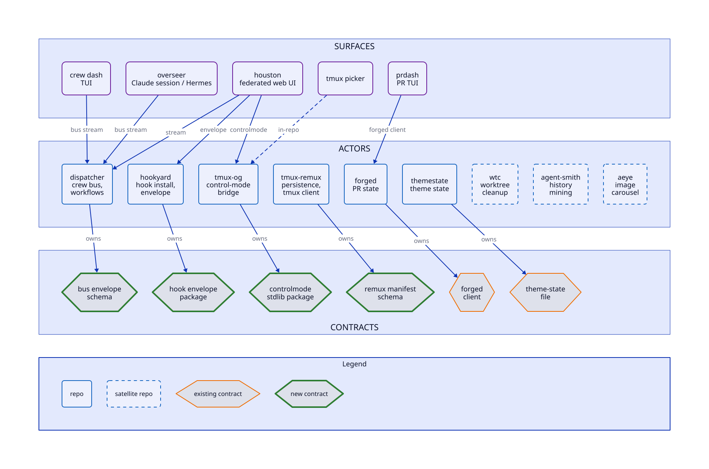

# .github

Shared community defaults, reusable workflows and the ecosystem ownership map for noamsto's tools.

- [Ecosystem ownership map](ecosystem/ownership-map.md): which repository owns each capability, the overlap catalogue and the enforcement proposals.
- [Reusable workflows](.github/workflows/README.md): workflows that tool repos call instead of keeping their own copies.

<picture>
  <source media="(prefers-color-scheme: dark)" srcset="ecosystem/target-layers-dark.svg">
  
</picture>
